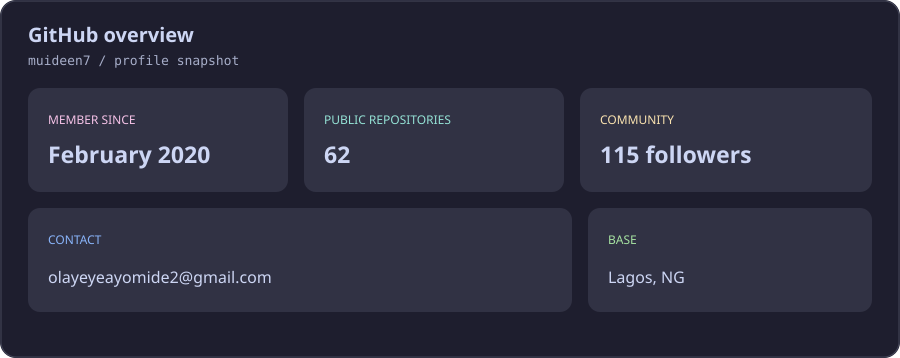

<div align="center">

<!-- ╭─── CAELESTIA WAYBAR (TOP PANEL) ───╮ -->
<p align="center">
  
  
  
  
</p>

<!-- ╭─── HERO BANNER ───╮ -->


<br/>

<!-- ╭─── FISH SHELL TYPING PROMPT ───╮ -->


</div>

<!-- ╭─── TILING WINDOW 1: FASTFETCH + QUICKFIRED DOCK ───╮ -->
```yaml
╭─ 󰣇 muideen7@caelestia ─ ~ ────────────────────────────────────────────────── ─╮
│                                                                               │
│   ╭───────────╮   ╭─ ✦ SYSTEM IDENTITY ───────────────────────────────────╮   │
│   │  ◕     ◕  │   │  󰀄  User       ::  Olayeye Muideen                    │   │
│   │     ▽     │   │  󰒓  Role       ::  Full-Stack Engineer (EEE B.Eng)    │   │
│   │  ╰─────╯  │   │  󰍹  Focus      ::  AI Tooling · SaaS · Design Systems │   │
│   │ caelestia │   │  󰇧  Philosophy ::  Considered, never templated        │   │
│   ╰───────────╯   │  󰅐  Uptime     ::  Shipping since 2020                │   │
│   ● ● ● ● ● ●     ╰───────────────────────────────────────────────────────╯   │
│                                                                               │
│ ╭─ 󰈺 fish ──────────────────────────────────────────────────────── 100% ───╮  │
│ │ ╭─ muideen7@caelestia in ~/socials on  main                             │  │
│ │ ╰─❯ echo $PHILOSOPHY                                                     │  │
│ │ "Engineering interfaces where electrical precision meets visual soul."   │  │
│ ╰──────────────────────────────────────────────────────────────────────────╯  │
╰───────────────────────────────────────────────────────────────────────────────╯
```

<p align="center">
  <a href="mailto:olayeyeayomide2@gmail.com"></a>
  <a href="https://linkedin.com/in/muideen7"></a>
  <a href="https://github.com/muideen7"></a>
  <a href="https://medium.com/@Frontendgeek"></a>
</p>

<br/>

<!-- ╭─── TILING WINDOW 2: ACTIVE WORKSPACES (PROJECTS) ───╮ -->
<p align="left">
  
  
  
</p>

<table align="center" width="100%">
<tr>
<td width="33%" valign="top">

```yaml
╭─ 01 // workspace:active ─── ─╮
│ 🧠 DevMentor AI              │
│ ──────────────────────────── │
│ AI-powered mentorship for    │
│ self-taught devs: roadmaps,  │
│ code reviews & check-ins.    │
╰──────────────────────────────╯
```
<div align="center">
  
  
  
  <br/><br/>
  <a href="https://dev-mentor-nu.vercel.app/">
    
  </a>
</div>

</td>
<td width="33%" valign="top">

```yaml
╭─ 02 // workspace:active ─── ─╮
│ 📊 Data.bes                  │
│ ──────────────────────────── │
│ Digital marketing & data     │
│ analysis studio — SEO,       │
│ analytics & growth strategy. │
╰──────────────────────────────╯
```
<div align="center">
  
  
  
  <br/><br/>
  <a href="https://databes.vercel.app/">
    
  </a>
</div>

</td>
<td width="33%" valign="top">

```yaml
╭─ 03 // workspace:active ─── ─╮
│ 🖤 Deep^style                │
│ ──────────────────────────── │
│ Editorial streetwear         │
│ storefront — curated drops,  │
│ lookbooks & style journal.   │
╰──────────────────────────────╯
```
<div align="center">
  
  
  
  <br/><br/>
  <a href="https://deepstyle-seven.vercel.app/">
    
  </a>
</div>

</td>
</tr>
</table>

<br/>

<!-- ╭─── TILING WINDOW 3: PACKAGES & DEPENDENCIES (STACK) ───╮ -->
<p align="left">
  
  
  
</p>

<div align="center">

```yaml
╭─ ✦ CORE RUNTIME & ARCHITECTURE ───────────────────────────────────────────── ─╮
│  frontend  ::  [ Next.js, React, TypeScript, TailwindCSS, Framer Motion ]     │
│  backend   ::  [ Node.js, Express, Prisma ORM, REST / tRPC ]                  │
│  datastore ::  [ PostgreSQL, MongoDB, Redis ]                                 │
│  devops    ::  [ Docker, Git, Vercel, Linux / Fish Shell ]                    │
╰───────────────────────────────────────────────────────────────────────────────╯
```


</div>

<br/>

<!-- ╭─── TILING WINDOW 4: BTOP SYSTEM MONITOR (STATS) ───╮ -->
<p align="left">
  
  
  
</p>

<table align="center" width="100%">
<tr>
<td width="50%" valign="top">


</td>
<td width="50%" valign="top">



</td>
</tr>
</table>

<br/>

<!-- ╭─── TILING WINDOW 5: CAVA / CONTRIBUTION MATRIX ───╮ -->
<p align="left">
  
  
  
</p>

<div align="center">
  
</div>

<br/>

<!-- ╭─── FOOTER SKYLINE & SESSION EXIT ───╮ -->


<div align="center">
<br/>

`╭─ muideen7@caelestia` · **building products as functional as they are memorable** · `╰─❯ exit 0`

</div>v
