<div align="center">

<!-- ╭─── CAELESTIA WAYBAR ═──╮ -->
<p align="center">
  
  
  
  
</p>

<!-- ╭─── ANIMATED TERMINAL ═──╮ -->


<br/>

<!-- ╭─── SOCIALS ═──╮ -->
<p align="center">
  <a href="mailto:olayeyeayomide2@gmail.com"></a>
  <a href="https://linkedin.com/in/muideen7"></a>
  <a href="https://github.com/muideen7"></a>
  <a href="https://medium.com/@Frontendgeek"></a>
  <a href="https://olayeyeayomide.netlify.app"></a>
</p>

</div>

<br/>

<!-- ╭─── ACTIVE WORKSPACES ═──╮ -->
<p align="left">
  
  
  
</p>

<table align="center" width="100%">
<tr>
<td width="33%" valign="top" align="center">
<pre><code>╭─ 01 // workspace:active ─── ─╮
│ 🧠 DevMentor AI              │
│ ──────────────────────────── │
│ AI-powered mentorship for    │
│ self-taught devs: roadmaps,  │
│ code reviews &amp; check-ins.    │
╰──────────────────────────────╯
</code></pre>


<br/>
<a href="https://dev-mentor-nu.vercel.app/"></a>
</td>
<td width="33%" valign="top" align="center">
<pre><code>╭─ 02 // workspace:active ─── ─╮
│ 📊 Data.bes                  │
│ ──────────────────────────── │
│ Digital marketing &amp; data     │
│ analysis studio — SEO,       │
│ analytics &amp; growth strategy. │
╰──────────────────────────────╯
</code></pre>


<br/>
<a href="https://databes.vercel.app/"></a>
</td>
<td width="33%" valign="top" align="center">
<pre><code>╭─ 03 // workspace:active ─── ─╮
│ 🖤 Deep^style                │
│ ──────────────────────────── │
│ Editorial streetwear         │
│ storefront — curated drops,  │
│ lookbooks &amp; style journal.   │
╰──────────────────────────────╯
</code></pre>


<br/>
<a href="https://deepstyle-seven.vercel.app/"></a>
</td>
</tr>
</table>

<br/>

<!-- ╭─── CORE RUNTIME ═──╮ -->
<p align="left">
  
  
  
</p>

```yaml
╭─ ✦ CORE RUNTIME & ARCHITECTURE ───────────────────────────────────────────── ─╮
│  frontend  ::  [ Next.js, React, TypeScript, TailwindCSS, Framer Motion ]     │
│  backend   ::  [ Node.js, Express, Prisma ORM, REST / tRPC ]                  │
│  datastore ::  [ PostgreSQL, MongoDB, Redis ]                                 │
│  devops    ::  [ Docker, Git, Vercel, Linux / Fish Shell ]                    │
╰───────────────────────────────────────────────────────────────────────────────╯
```

<div align="center">

</div>

<br/>

<!-- ╭─── MATRIX ═──╮ -->
<p align="left">
  
  
  
</p>

<div align="center">

</div>

<br/>

<!-- ╭─── WHOAMI ═──╮ -->
<p align="left">
  
  
  
</p>

<details>
<summary><code>╭─ muideen7@caelestia ~ whoami</code></summary>

<br/>

Hi, I'm **@AyomideOlayeye** — a full-stack engineer (EEE, B.Eng) based in Lagos, NG.

- I love connecting with people and learning.
- Part-time freelancer crafting user experiences and design systems for software, web and mobile products.
- 👀 Interested in **coding**, tooling and AI systems.
- 🌱 Currently learning **software engineering**.
- 💞️ Looking to **collaborate** on programming.
- 📫 Reach me at **[olayeyeayomide2@gmail.com](mailto:olayeyeayomide2@gmail.com)** or **+234 913 503 8685**.
- 🌐 Website: **[olayeyeayomide.netlify.app](https://olayeyeayomide.netlify.app)**

Contact me for freelance/contract work, consulting, or if you just want to chat — I'd be happy to hear from you.

</details>

<br/>

<!-- ╭─── SESSION EXIT ═──╮ -->
<div align="center">

`╭─ muideen7@caelestia` · **building products as functional as they are memorable** · `╰─❯ exit 0`

</div>
